<!-- Imagens geradas por scripts/build_assets.py (pip install fonttools pillow). Edite os textos lá e rode: python scripts/build_assets.py -->

  

  <picture><source media="(prefers-color-scheme: light)" srcset="assets/section-about-light.svg"></picture>

  

  

  <picture><source media="(prefers-color-scheme: light)" srcset="assets/section-journey-light.svg"></picture>

  

  <picture><source media="(prefers-color-scheme: light)" srcset="assets/section-focus-light.svg"></picture>

  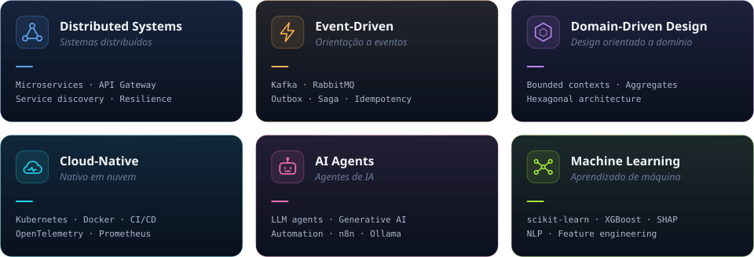

  <picture><source media="(prefers-color-scheme: light)" srcset="assets/section-work-light.svg"></picture>

  <a href="https://github.com/andrebecker84/cinepass-ddd-event-driven-AT">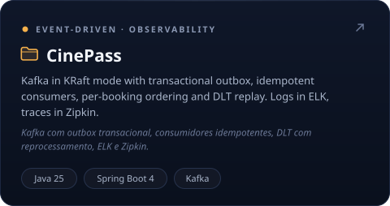</a>
  <a href="https://github.com/andrebecker84/TP5-PB_producao">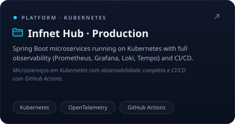</a>
  <a href="https://github.com/andrebecker84/TP4-PB_eventos">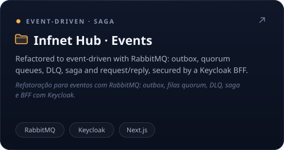</a>
  <a href="https://github.com/andrebecker84/ecommerce-ddd-async-messaging-TP3">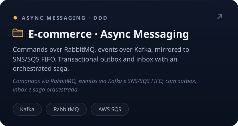</a>
  <a href="https://github.com/andrebecker84/microservices-devops-api-vendas-TP3">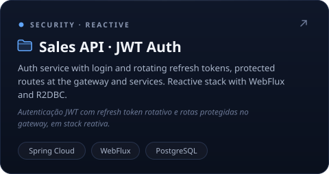</a>
  <a href="https://github.com/andrebecker84/ecommerce-ddd-refactoring-TP1">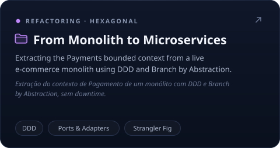</a>
  <a href="https://github.com/andrebecker84/ml-portfolio">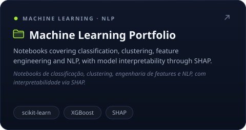</a>

  

  <picture><source media="(prefers-color-scheme: light)" srcset="assets/section-education-light.svg"></picture>

  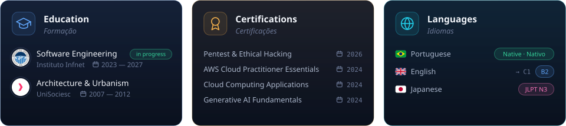

  <picture><source media="(prefers-color-scheme: light)" srcset="assets/section-toolbox-light.svg"></picture>

   
  <picture><source media="(prefers-color-scheme: light)" srcset="assets/caption-languages-light.svg"></picture>

   
  <picture><source media="(prefers-color-scheme: light)" srcset="assets/caption-messaging-light.svg"></picture>

   
  <picture><source media="(prefers-color-scheme: light)" srcset="assets/caption-platform-light.svg"></picture>

  <picture><source media="(prefers-color-scheme: light)" srcset="assets/section-connect-light.svg"></picture>

  
  
  

  <picture><source media="(prefers-color-scheme: light)" srcset="assets/footer-light.svg"></picture>

